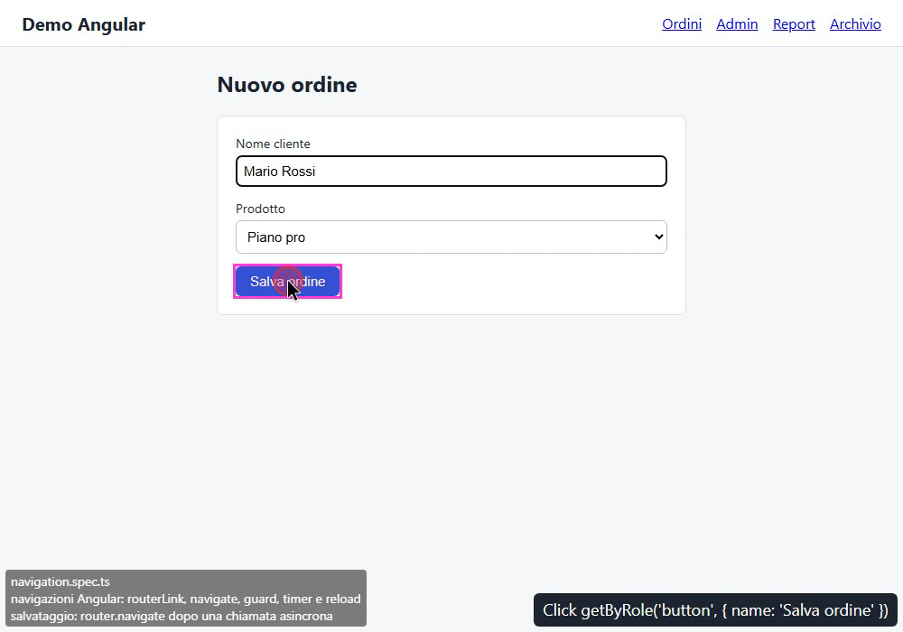
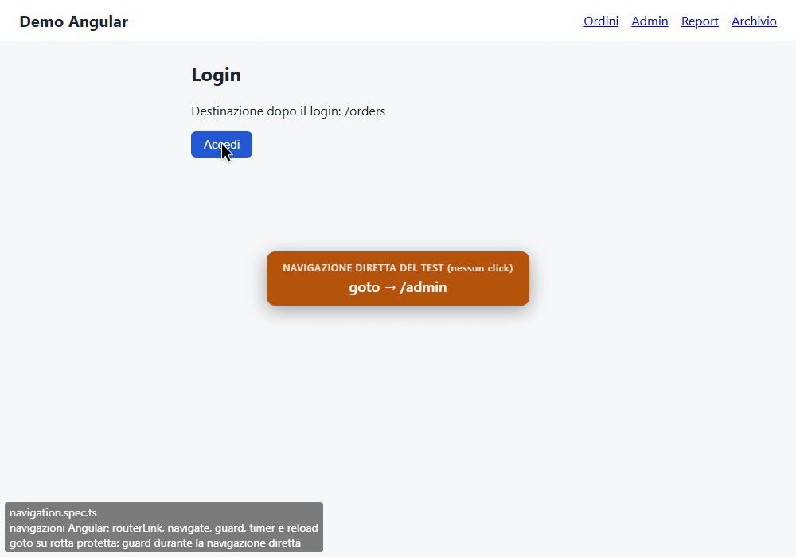
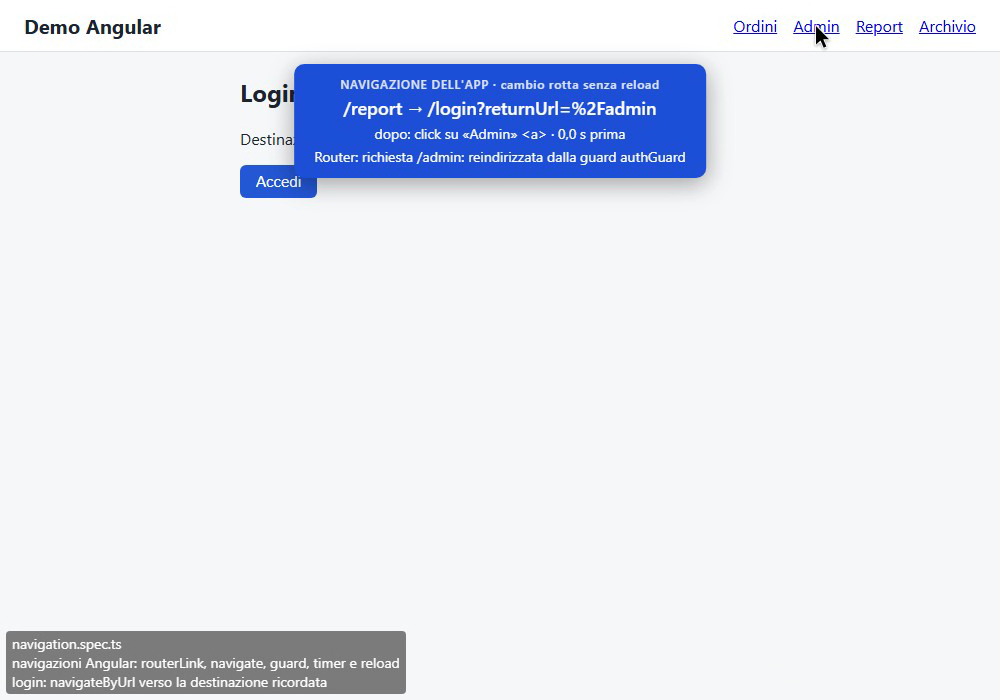
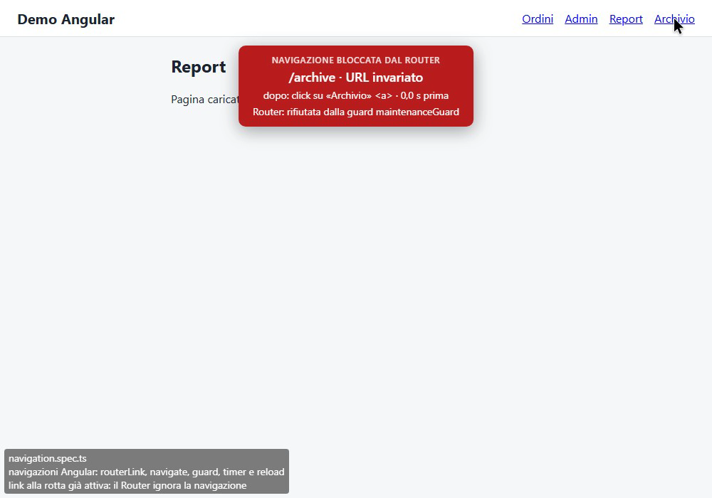
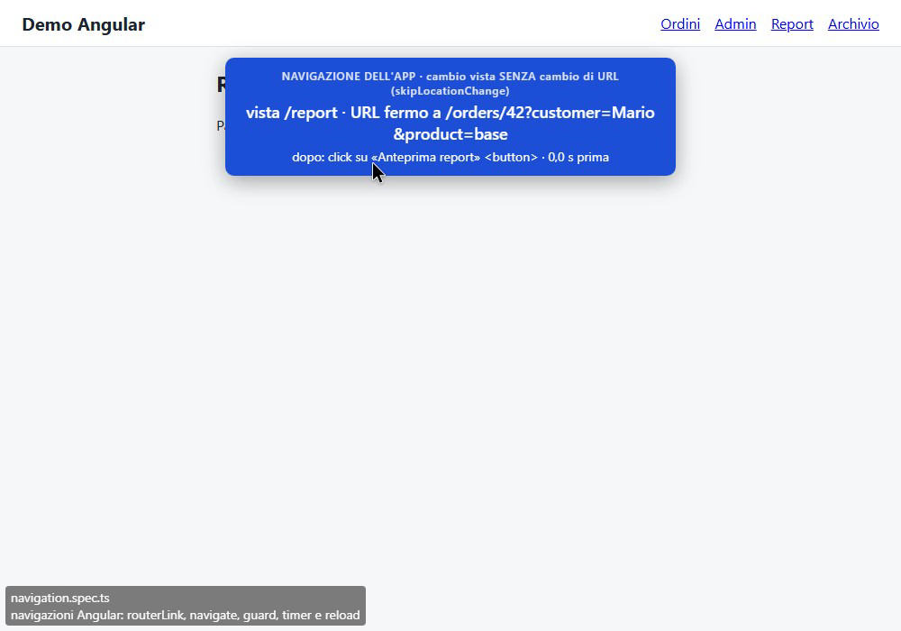
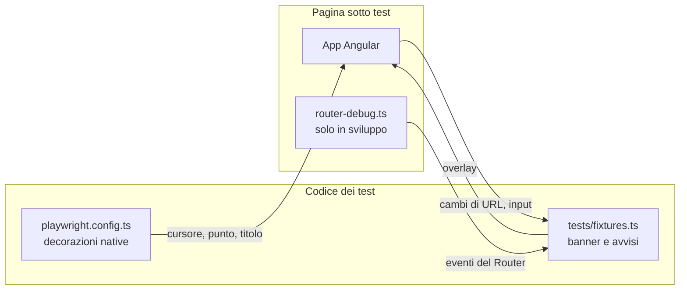

# Test Playwright che si lasciano guardare

Proof of concept, con demo funzionante su Angular, di una strategia per **rendere visibile a un essere umano quello che un test Playwright sta facendo**: dove clicca, cosa scrive, e soprattutto *perché la pagina è cambiata*.



## Il problema

Playwright sa eseguire un test in una finestra visibile e sa anche rallentarlo. Quello che non mostra è il mouse: si vedono campi che si riempiono da soli e pagine che cambiano all'improvviso, senza capire come ci si è arrivati. È stato un click? Su cosa? Oppure il test ha cambiato l'URL direttamente? O è stata l'app a reindirizzare?

Il problema pesa di più quando i test li scrive un agente AI: chi li deve rivedere vuole *guardare* l'esecuzione e capire in pochi secondi se il test fa davvero quello che dichiara.

## Cosa si ottiene

Lanciando gli stessi test con una variabile d'ambiente, ogni evento diventa leggibile, uno alla volta:

| Evento | Cosa si vede |
|---|---|
| Click, compilazione di un campo, selezione | Cursore animato, punto di click, riquadro sull'elemento, titolo dell'azione |
| Il test cambia pagina direttamente (`goto`, `reload`, indietro, avanti) | Banner arancione al centro, **prima** della navigazione |
| L'app cambia rotta (`routerLink`, `router.navigate`, redirect) | Avviso blu: da dove a dove, dopo quale azione e quanto tempo prima |
| L'app ricarica la pagina (`window.location`) | Avviso blu che lo distingue da un cambio di rotta |
| Una guard reindirizza o rifiuta | Nome della guard; se rifiuta, avviso rosso "navigazione bloccata" |
| Click su un link alla rotta già attiva | Avviso grigio "navigazione ignorata" |
| Cambio di vista senza cambio di URL (`skipLocationChange`) | Avviso blu che lo dichiara esplicitamente |

Senza la variabile, i test girano esattamente come prima: nessuna decorazione, nessuna pausa.

| Navigazione diretta del test | Navigazione dell'app |
|---|---|
|  |  |

| Navigazione bloccata da una guard | Vista cambiata senza cambio di URL |
|---|---|
|  |  |

Il video completo della demo (circa 50 secondi) è in [docs/demo.webm](docs/demo.webm).

## Provalo

Serve Node.js (la demo è stata sviluppata con Node 24).

```bash
npm install
```

```bash
npm run setup
```

Il secondo comando installa le dipendenze dell'app Angular di esempio e scarica Chromium per Playwright.

| Comando | Cosa fa |
|---|---|
| `npm test` | Esegue i test normalmente: nessuna decorazione, circa 4 secondi |
| `npm run test:show` | Esegue i test in una finestra visibile, rallentati e con tutte le decorazioni |
| `npm run test:video` | Come sopra ma senza finestra: produce il video in `test-results/` |
| `npm run check:prod` | Compila l'app in produzione e verifica che il codice di debug non sia nel bundle |

Il ritmo si regola con `PW_SHOW_PACE`: `1` è il valore predefinito, `1.5` è più lento, `0.5` più veloce.

```bash
npx cross-env PW_SHOW_ACTIONS=1 PW_SHOW_PACE=1.5 playwright test --headed
```

## Come funziona, in breve

La strategia è fatta di tre pezzi indipendenti. I primi due vivono nel codice dei test; il terzo è opzionale e vive nell'app, ma solo nelle build di sviluppo.



1. **Decorazioni native di Playwright** ([playwright.config.ts](playwright.config.ts)). Dalla versione 1.59 Playwright sa annotare le azioni; con la 1.64 si possono mostrare anche punto di click e riquadro sull'elemento. Basta configurarle.
2. **Una fixture** ([tests/fixtures.ts](tests/fixtures.ts)). Le decorazioni native non coprono i cambi di pagina. La fixture annuncia le navigazioni dirette del test, rileva quelle avviate dall'app e le attribuisce all'ultima azione del test.
3. **Un ponte sugli eventi del Router** ([demo-angular/src/app/router-debug.ts](demo-angular/src/app/router-debug.ts)). Guardando solo l'URL non si può sapere quale guard è intervenuta, né accorgersi di una navigazione bloccata. Il ponte inoltra gli eventi del Router alla fixture. Senza il ponte la fixture funziona lo stesso, con meno dettagli.

La spiegazione completa, con le scelte di progetto e le insidie incontrate, è in [docs/come-funziona.md](docs/come-funziona.md).

## Non contamina l'app

L'obiettivo dichiarato è che **nel pacchetto di deploy non finisca nulla che serva a questo tipo di debug**.

- I pezzi 1 e 2 sono codice dei test: non vengono mai impacchettati.
- Il pezzo 3 è nel sorgente dell'app, ma è registrato dietro `ngDevMode`. Nelle build di produzione quella condizione è la costante `false` e il bundler elimina sia la registrazione sia il file.

Questa garanzia è verificata da un controllo automatico, non affidata alla fiducia:

```bash
npm run check:prod
```

Lo script compila l'app in produzione, cerca nel bundle il marcatore del ponte e fallisce se lo trova. È stato provato in entrambi i sensi: passa con la configurazione corretta e fallisce se il ponte viene registrato senza la condizione.

## Vantaggi

- **Nessuna modifica ai test esistenti**, a parte l'import di `test` ed `expect` dalla fixture.
- **Una sola variabile d'ambiente** separa la modalità "da guardare" da quella normale. In CI non cambia nulla.
- **Si capisce la causa dei cambi di pagina**, non solo che sono avvenuti: test, azione dell'utente simulata, redirect, guard, timer.
- **Rende visibili eventi che altrimenti non lasciano traccia**: un click che non porta da nessuna parte, una vista che cambia senza che cambi l'URL.
- **Un evento alla volta**: le azioni aspettano che l'avviso precedente sia stato letto.
- **Funziona sia dal vivo sia in video**, con le stesse decorazioni.
- **Il pacchetto di deploy resta pulito**, con un controllo automatico a garantirlo.

## Limiti

- **È un proof of concept.** È stato provato solo su questa app di esempio, con Angular 22, Playwright 1.65 e Chromium, su Windows. Non è stato provato su un'applicazione reale.
- **La causa di una navigazione è una deduzione temporale.** L'avviso dice quale azione ha preceduto il cambio di pagina e di quanto, ma non può dimostrare che l'abbia provocato.
- **Con più guard sulla stessa rotta non si sa quale ha deciso.** Il Router non lo comunica: l'avviso elenca quelle configurate.
- **Le guard scritte come funzioni anonime** compaiono come "(anonima)".
- **Le navigazioni spontanee dell'app non si possono trattenere.** Se un timer dell'app cambia pagina mentre un avviso è ancora a schermo, il nuovo avviso sostituisce il precedente.
- **Errori di navigazione, resolver e navigazioni indietro/avanti** sono gestiti nel codice ma non esercitati dalla demo.
- **Copre solo la scheda principale**, non popup o nuove schede.
- **Usa API giovani di Playwright**, che potrebbero cambiare, e in modalità "da guardare" avvolge i metodi dei `Locator`: se un test fallisce in quella modalità, la prima riga dello stack indica la fixture e la riga del test è subito sotto.
- **L'esclusione dalla produzione si appoggia a `ngDevMode`**, un meccanismo interno di Angular e non un'API documentata. Per questo esiste `check:prod`.
- **Il ponte è specifico per Angular.** I pezzi 1 e 2 valgono per qualunque applicazione web.

## Portarlo nel proprio progetto

La guida passo passo è in [docs/integrazione.md](docs/integrazione.md). In sintesi: si copiano due file nei test, si aggiunge un blocco alla configurazione di Playwright e, se si vuole il dettaglio sul Router, un file e una riga nell'app Angular.

## Struttura del repository

```text
playwright.config.ts          decorazioni native, attive con PW_SHOW_ACTIONS=1
tests/
  pace.ts                     tempi della modalità "da guardare"
  fixtures.ts                 banner, avvisi di navigazione, attesa delle azioni
  navigation.spec.ts          test di esempio: uno scenario per ogni tipo di navigazione
demo-angular/                 app Angular di esempio
  src/app/router-debug.ts     ponte sugli eventi del Router (solo sviluppo)
  src/app/app.config.ts       registrazione del ponte dietro ngDevMode
scripts/
  check-prod-bundle.mjs       controllo che il ponte non sia nel bundle di produzione
docs/
  come-funziona.md            architettura, scelte di progetto, insidie
  integrazione.md             guida per adottare la strategia in un altro progetto
```

## Versioni provate

| Componente | Versione |
|---|---|
| Playwright | 1.65.1 |
| Angular | 22.2 |
| Node.js | 24.18 |
| Browser | Chromium |
| Sistema operativo | Windows 11 |

## Licenza

[MIT](LICENSE)
